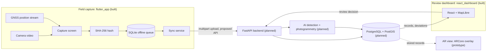
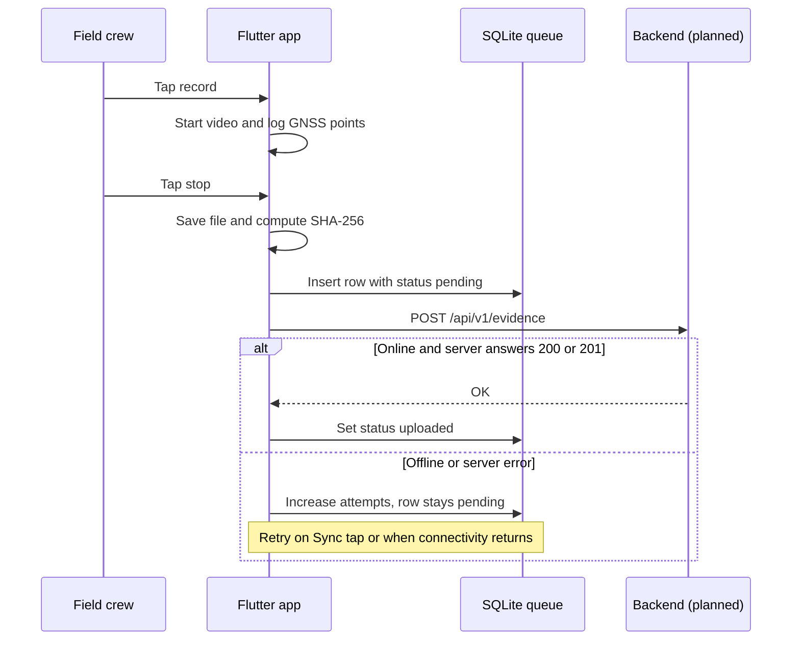
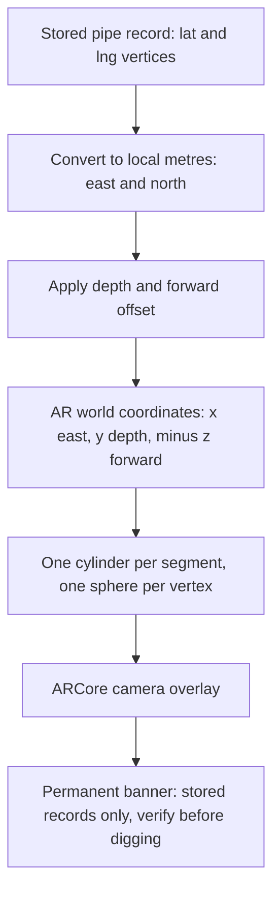
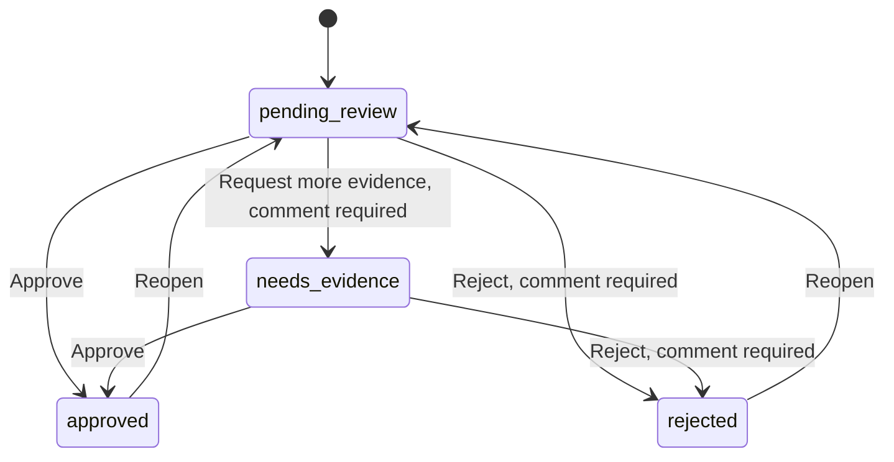

# GeoTrace GIS: Technical Design Document

Scope of this document: the mobile, AR and review-dashboard parts in this repository, and the interfaces they need from the backend. Items that are not built yet are labelled **Planned**.

## 1. Purpose

Underground pipes are often laid differently from the CAD plan, and the changes are not recorded before the trench is backfilled. GeoTrace records the exposed pipe with evidence, compares planned and actual routes, and gives an owner a way to approve the record. Later crews can then work from verified records.

## 2. Status: what is built and what is planned

| Capability | Where | Status |
|---|---|---|
| Camera video capture | `flutter_app` | Built |
| GNSS track logging with accuracy | `flutter_app` | Built |
| SHA-256 evidence hash | `flutter_app` | Built |
| Offline SQLite queue and auto-retry upload | `flutter_app` | Built |
| AR overlay of stored record (mock data) with safe-dig warning | `flutter_app`, Android | Prototype |
| Planned vs actual map with deviation layer | `react_dashboard` | Built (sample data) |
| Approve, reject, request more evidence, audit log | `react_dashboard` | Built (local state) |
| REST API, evidence storage, PostgreSQL + PostGIS | Backend | Planned (backend owner) |
| AI pipe and fitting detection, photogrammetry | Backend | Planned |
| DXF / GeoPackage export | Backend | Planned |
| iOS ARKit overlay, real geo-anchoring | `flutter_app` | Planned |

## 3. System architecture



### Components

| Component | Technology | Responsibility |
|---|---|---|
| Capture screen | Flutter, `camera`, `geolocator` | Record video and log GNSS points while recording |
| Evidence integrity | `crypto` (SHA-256) | Hash the saved video file so the backend can detect changes |
| Offline queue | `sqflite` | Persist every clip before upload |
| Sync service | `http`, `connectivity_plus` | Upload pending clips, retry when the connection returns |
| AR view | `arcore_flutter_plugin`, `vector_math` | Draw stored pipe geometry on the camera feed |
| Review dashboard | React 18, Vite, MapLibre GL JS | Show planned vs actual, manage approval workflow |

## 4. Mobile capture design

### 4.1 Capture and upload sequence



### 4.2 Offline queue schema

Table `queue` in `geotrace_queue.db`:

| Column | Type | Meaning |
|---|---|---|
| `id` | TEXT, primary key | UUID v4 of the evidence item |
| `video_path` | TEXT | Path of the saved `.mp4` in app storage |
| `sha256` | TEXT | Hex SHA-256 of the saved video |
| `track` | TEXT | JSON array of GNSS points (below) |
| `captured_at` | TEXT | UTC ISO 8601 time when recording stopped |
| `status` | TEXT | `pending` or `uploaded` |
| `attempts` | INTEGER | Number of failed upload attempts |

GNSS point format inside `track`:

```json
{"lat": 26.4, "lng": 75.87, "alt": 412.3, "acc_m": 3.2, "t": "2026-10-14T08:00:00.000Z"}
```

### 4.3 Design decisions

- **Write locally first.** A clip is saved and queued before any network call, so a dropped connection never loses evidence.
- **Hash on the device.** The hash is computed from the saved file, so the backend can recompute it and detect any change after capture.
- **Only one camera user at a time.** The home screen builds only the selected tab, so the camera and AR views never run together.
- **Accuracy is recorded.** Every GNSS point stores its reported accuracy in metres. Phone GNSS is not survey grade, which is why the pitch uses survey points as the geometry anchor.

## 5. AR design



Conversion used by the prototype (relative to the first vertex):

- `north_m = (lat - lat0) * 111320`
- `east_m = (lng - lng0) * 111320 * cos(lat0)`

**Guardrail.** The AR screen always shows a banner that cannot be dismissed: AR shows stored records only, it does not detect buried pipes, and users must verify with the owner, a licensed surveyor and by hand-digging. On non-Android devices the AR tab shows only this warning.

**Limitations of the prototype.** The mock pipe is anchored to the phone's starting pose, with no compass or geo-anchoring, so it does not appear at its real-world location. Real geo-anchoring is planned.

## 6. Review dashboard design

### 6.1 Review workflow



Every decision is appended to the audit log with a timestamp and the reviewer comment. Approved and rejected records are locked until reopened.

### 6.2 Map layers

| Layer | Meaning | Style |
|---|---|---|
| `planned` | CAD design route | Dashed teal line |
| `actual` | As-built route from survey points | Solid blue line |
| `deviation` | Part of the actual route that departs from the plan | Thick red line |
| `survey` | Survey control points with labels | Orange circles |

GeoJSON coordinates use `[longitude, latitude]` order everywhere in this repository.

## 7. Interfaces (proposed, to be confirmed with the backend owner)

### 7.1 Upload evidence

`POST /api/v1/evidence` with `multipart/form-data`:

| Field | Type | Example |
|---|---|---|
| `id` | string (UUID) | `3f2b8c1e-5a4d-4e0b-9c7a-1d2e3f4a5b6c` |
| `sha256` | string (hex) | `0f4f7987...862a` |
| `captured_at` | string (UTC ISO 8601) | `2026-10-14T08:00:30.000Z` |
| `track` | string (JSON array) | see section 4.2 |
| `video` | file (`.mp4`) | recorded clip |

The app treats status `200` or `201` as success. Anything else, or no connection, leaves the item queued.

### 7.2 Review decision

`PATCH /api/v1/records/{id}/review` with JSON:

```json
{"status": "rejected", "comment": "Depth label missing in video"}
```

Allowed `status` values: `approved`, `rejected`, `needs_evidence`, `pending_review`.

## 8. Security and integrity

| Topic | Current state | Planned |
|---|---|---|
| Evidence integrity | SHA-256 computed on device and sent with the upload | Backend recomputes and stores the hash |
| Transport | Plain HTTP allowed in the Android build for local development only | HTTPS only; remove the cleartext setting before release |
| Authentication and roles | Not implemented | Roles for crew, reviewer and owner; audit logs on the backend |
| Evidence storage | Local app storage on the phone | Encrypted evidence storage on the backend |
| Secrets | None in this repository | Keep it that way; `.env` is git-ignored |

## 9. Safety guardrails

- The AR view only displays stored records and says so permanently on screen.
- Map and AR show sample data in this prototype and label it as sample or mock.
- Records are drafts until a reviewer approves them, and approval state is always visible.

## 10. Testing

See [TEST_CASES.md](TEST_CASES.md). One automated test (`python tests/test_sample_data.py`) validates the sample GeoJSON, the expected 6 m deviation, and the SHA-256 of the sample evidence. The remaining tests are manual because they need a physical phone.

## 11. Known limitations and roadmap

1. Backend, AI detection and photogrammetry are not in this repository.
2. AR is a mock overlay on Android only.
3. The dashboard reads bundled sample data and keeps its audit log in the browser.
4. Next steps: connect both apps to the backend, real geo-anchored AR, ARKit on iOS, pilot on one water-pipeline site compared against a reference survey.
